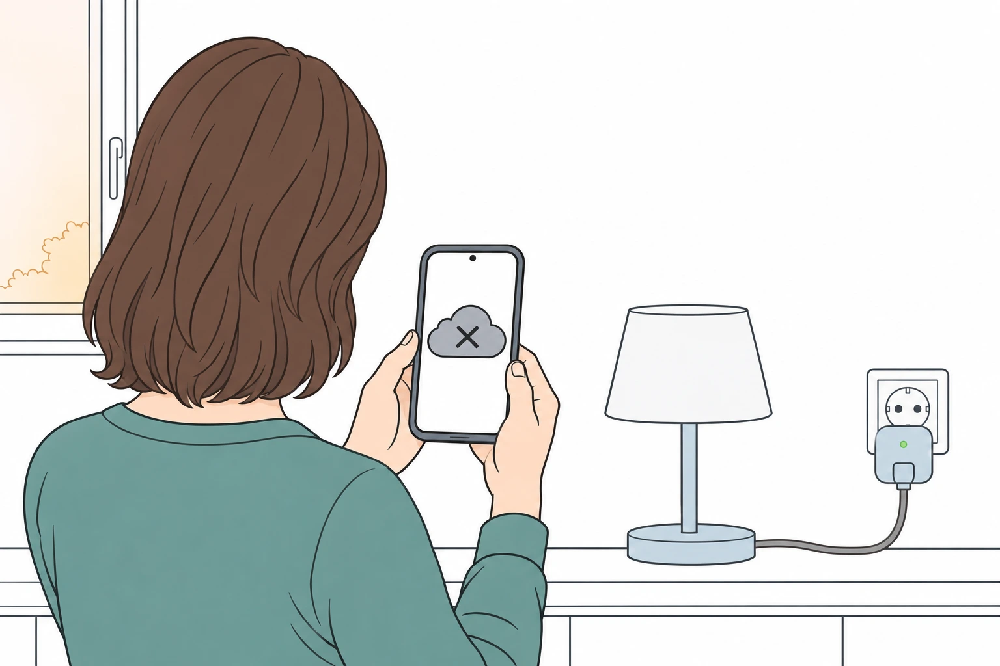
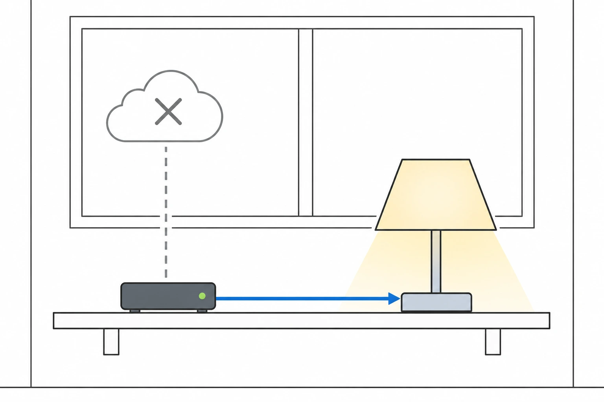
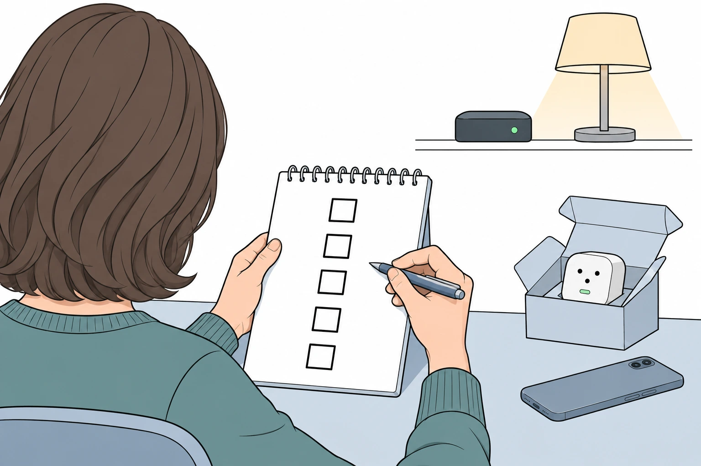

Eines Morgens meldet die App: «Dieser Dienst wurde eingestellt.» Die Lampen hängen, wo sie hingen, die Steckdosen sind noch in der Wand. Aber was sie smart gemacht hat, war nie in Ihrem Haus. Es lag auf einem Server, und die Firma, die ihn betrieben hat, hat aufgehört.

Das ist kein Gedankenspiel. Es ist oft genug passiert, dass sich klare Muster zeigen. Hier drei neuere Fälle.

<figure class="blog-post__figure">
  
</figure>

## Drei echte Abschaltungen

- **Gigaset, März 2024.** Gegen das deutsche Unternehmen wurde am 29. Januar 2024 das Insolvenzverfahren eröffnet. Das Telefoniegeschäft fand einen Käufer, das Smart-Home-Geschäft nicht, und laut Firma erlaubt das Insolvenzrecht nicht, die Dienste weiter zu betreiben ([Gigaset](https://service.gigaset.com/es/support/solutions/articles/75000121662-why-is-the-gigaset-smart-home-system-no-longer-usable-)). Am 29. März 2024 wurde die Cloud abgeschaltet. Laut dem Schweizer Fachmagazin [IT Reseller](https://www.itreseller.ch/Artikel/100542/Gigaset_beendet_Smart-Home-Unterstuetzung.html) lief nur der Rauchmelder weiter.
- **Belkin Wemo, Januar 2026.** Belkin kündigte im Juli 2025 an ([TechCrunch](https://techcrunch.com/2025/07/10/belkin-ends-support-for-most-wemo-devices-and-its-wemo-app)), die Wemo-Cloud am 31. Januar 2026 abzuschalten. Danach funktionierten die App, der Fernzugriff und die Anbindung an Alexa und Google Assistant nicht mehr, und neue Geräte liessen sich nicht mehr über die App einrichten. Geräte, die vor der Frist mit Apple HomeKit eingerichtet worden waren, liefen lokal weiter, ebenso die Thread-Modelle ([Belkin](https://www.belkin.com/support-article/?articleNum=335419)).
- **Bose SoundTouch, Mai 2026.** Bose kündigte im Oktober 2025 das Ende der Cloud-Unterstützung an, verschob den Termin nach Kritik und schaltete die Cloud am 6. Mai 2026 ab. Voreinstellungen und die Suche nach Musikdiensten in der App fielen weg, und es gibt keine Sicherheitsupdates mehr. Bluetooth, AirPlay bei einigen Modellen, Spotify Connect und der AUX-Eingang funktionieren weiter, und Bose hat die technische Dokumentation der Schnittstelle veröffentlicht ([PC-WELT](https://www.pcwelt.de/article/3032259/bose-soundtouch-support-ende-tipps.html)).

Noch ein Fall, in einem Satz, weil es eine US-Marke ist: Im April 2022 wurde die US-Firma Insteon still, ohne ihre Kunden zu warnen. Die physischen Schalter funktionierten weiter, die Automatisierung nicht ([The Register](https://www.theregister.com/2022/04/19/insteon_cloud_shutdown/)).

## Warum das passiert

Die drei Geschichten enden verschieden: Eine Firma wird zahlungsunfähig, eine Firma entscheidet, dass sich eine Produktlinie nicht mehr lohnt, ein Produkt wird einfach alt. Der Kern ist immer derselbe. Das Gerät braucht den Server des Herstellers, um seine Arbeit zu tun, und ein Server kostet jeden Monat Geld. Hört das Geld auf, hört der Dienst auf, und die Hardware in Ihrer Wand ist trotzdem völlig in Ordnung.

## Was weiter funktionierte

Schauen Sie die Listen noch einmal an. Überlebt hat, was lokal gesprochen hat: die Wemo-Geräte mit HomeKit, die Thread-Modelle, die Bose-Lautsprecher über Bluetooth oder Kabel, die Insteon-Wandschalter, der Gigaset-Rauchmelder. Was von der Cloud abhing, ging. Was seine Aufgabe allein erfüllen konnte, blieb.

Nach dieser Regel plane ich.

<figure class="blog-post__figure">
  
</figure>

## Was ich anders mache

In einem Konihaus-Zuhause ist das Gehirn eine kleine Zentrale in Ihrem eigenen Haus, auf der Home Assistant läuft. Die Geräte sprechen lokal mit ihr, über offene Standards wie Zigbee, und die Automatisierungen laufen dort. Es gibt kein Konto bei einem Hersteller, von dem das Zuhause abhängt. Die Überlegung dahinter habe ich in [Kein Vendor Lock-in](/de/insights/kein-vendor-lock-in/) und in [Funktioniert es auch in zehn Jahren noch?](/de/insights/zukunftssicher/) beschrieben.

Home Assistant selbst zeigt, wie eine Cloud aussehen kann. Der optionale Online-Dienst, bisher Home Assistant Cloud, wird in Home Assistant Link umbenannt: Die Umbenennung wurde am 2. Oktober 2026 angekündigt und ist für die Dezember-Version geplant. Link bietet Fernzugriff, die Anbindung an Alexa und Google Home, Spracherkennung online, verschlüsselte Backups und menschlichen Support. Das Projekt sagt klar, dass das Zuhause ohne den Dienst weiterläuft, auch wenn Sie das Abo kündigen ([Home Assistant](https://www.home-assistant.io/blog/2026/10/02/big-tech-ruined-the-cloud-so-were-renaming-ours/)).

Das ist die Reihenfolge, die ich will: die Cloud als Extra, das man abschalten kann, nicht als Fundament.

## Ehrliche Grenzen

- **Lokal heisst nicht für immer.** Hardware fällt aus, und eine Firma, die verschwindet, schickt auch keine Updates mehr. Bose gibt an, nach Mai 2026 keine Sicherheitsupdates mehr zu liefern, deshalb gehört ein solches Gerät in ein privates Netz.
- **Manches braucht von Natur aus das Internet.** Eine Wettervorhersage, ein Musikdienst, ein Sprachassistent eines Grosskonzerns: Verschwindet der Dienst, verschwindet diese Funktion. Das Licht, die Heizung und die Schlösser sollten nicht mitgehen.
- **Ein optionaler Dienst bleibt ein Dienst.** Wenn Sie den Fernzugriff über den Dienst einer Firma nutzen, lohnt es sich, die Alternative zu kennen. In einem Konihaus-Zuhause läuft der Fernzugriff über ein verschlüsseltes VPN.
- **Ich kann Ihnen nicht sagen, welche Firma in zehn Jahren noch existiert.** Das kann niemand. Genau deshalb ist die Frage, wie viel kaputtgeht, wenn eine nicht mehr existiert.

## Fünf Fragen vor dem Kauf

1. **Funktioniert es auch ohne Internet,** zumindest die Grundfunktionen?
2. **Braucht es ein Konto beim Hersteller,** damit es im Alltag läuft?
3. **Spricht es einen offenen Standard** wie Zigbee, Matter oder Thread, sodass eine andere Zentrale übernehmen könnte?
4. **Wo läuft das Gehirn,** bei Ihnen zu Hause oder auf dem Server des Herstellers?
5. **Was passiert, wenn die Firma verschwindet?** Lautet die ehrliche Antwort «es hört auf», überlegen Sie es sich zweimal, besonders bei Schlössern, Rauchmeldern und Heizung.

<figure class="blog-post__figure">
  
</figure>

## Wenn Sie schon Geräte nur mit Cloud haben

Sie müssen heute nichts wegwerfen. Finden Sie heraus, welche Funktionen auch ohne Cloud laufen, nutzen Sie das Gerät, solange es funktioniert, und ersetzen Sie Schritt für Schritt. Beginnen Sie mit dem, was für die Sicherheit zählt: Türschlösser, Rauch- und Wassermelder, Heizung. Wenn Sie eine zweite Meinung zu dem möchten, was Sie zu Hause haben, schaue ich es gerne mit Ihnen an.

---

**Unsicher, welche Ihrer Geräte einen Server brauchen?** [Sprechen Sie mit Koni](https://konihaus.ch/#contact). Das erste Gespräch ist kostenlos und unverbindlich.
