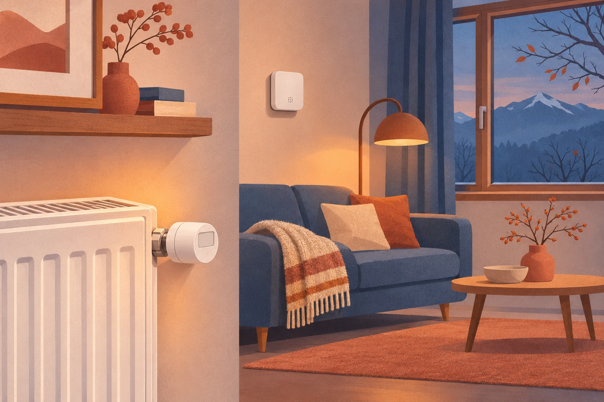
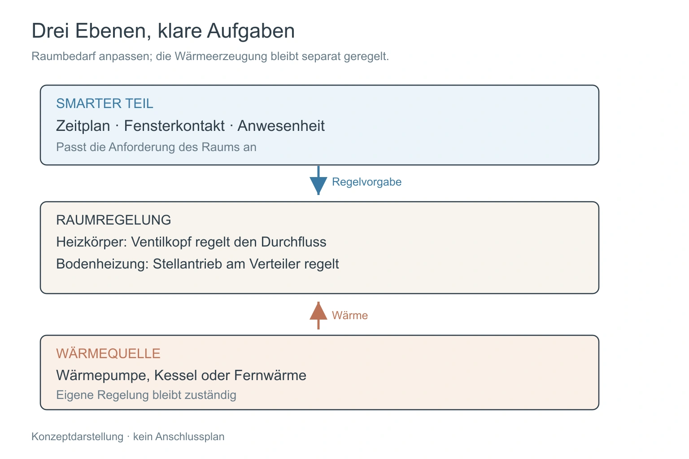
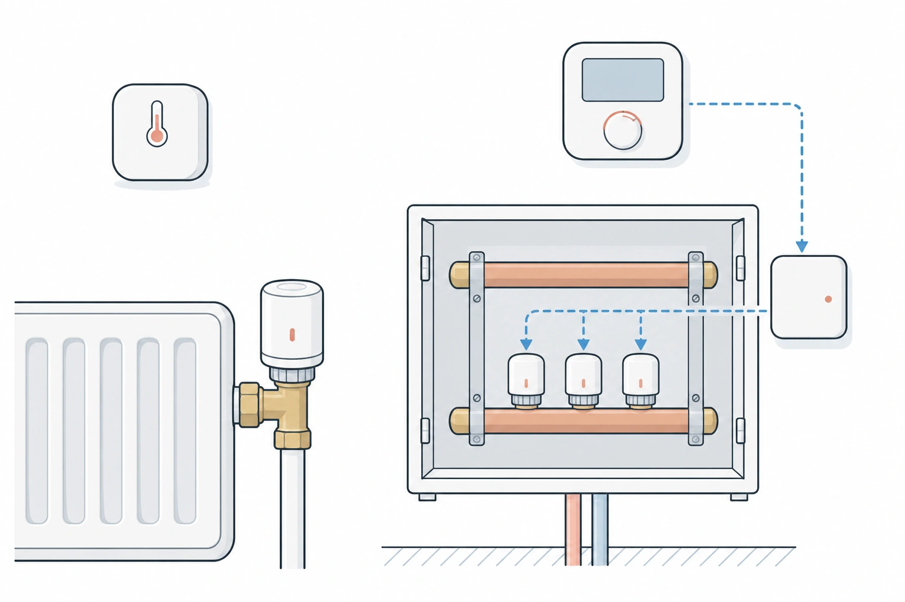
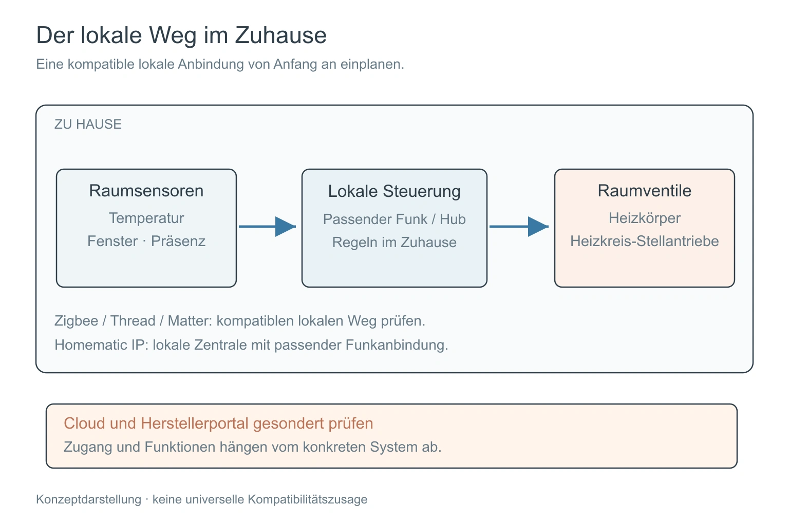
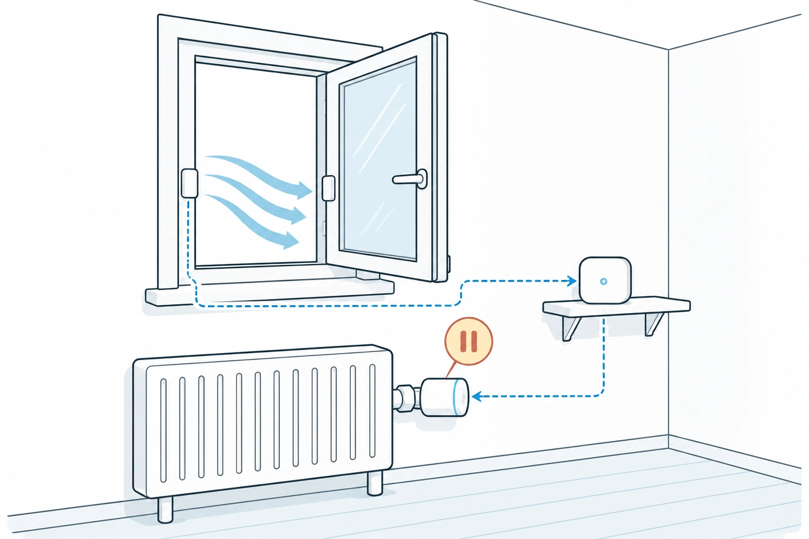
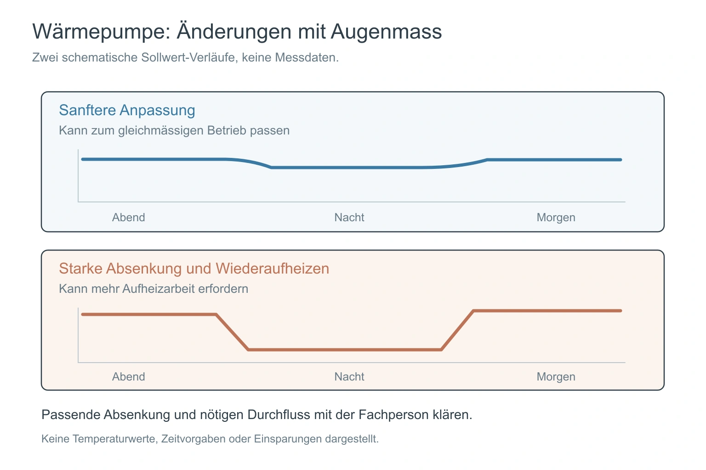

Bei der Heizung kann sich ein Smart Home still bezahlt machen, und bei der Heizung kann es still alles verschlechtern. Die Heizung ist in den meisten Haushalten der grösste Energieverbraucher, kleine Fehler sind also teuer. Und es ist der Bereich mit der grössten Verwirrung, weil drei verschiedene Geräte alle behaupten, das Sagen zu haben: das Raumthermostat, die Heizkörperventile und die Wärmepumpe selbst.

Das ist der vierte Beitrag der Serie über die Teile eines Smart Homes, nach [smartem Licht](/de/insights/smarte-beleuchtung-schweiz/), [smarten Storen](/de/insights/smarte-storen-schweiz/) und [Sensoren](/de/insights/smart-home-sensoren/). Es sind dieselben Fragen wie zuvor: Was bringt es Ihnen, was sollten Sie vor dem Kauf prüfen, und wo liegen die ehrlichen Grenzen? Zahlen zu Einsparungen verspreche ich nicht. Sie hängen von Ihrem Gebäude, Ihrer Heizung und Ihrem Alltag ab.

<figure class="blog-post__figure">
  
</figure>

## Wer hat das Sagen?

Stellen Sie sich drei Ebenen vor.

**Die Wärmequelle** erzeugt die Wärme: eine Wärmepumpe, ein Gas- oder Ölkessel, Fernwärme. Sie hat eine eigene Regelung, meist nach der Aussentemperatur.

**Der Raum** entscheidet, wie viel Wärme er will. In einem Haus mit Heizkörpern ist das das Heizkörperventil, der kleine Kopf an jedem Heizkörper, der den Durchfluss öffnet und schliesst. Bei einer Bodenheizung misst und fragt das Wandthermostat nur an. Geregelt wird am Heizkreisverteiler, meist in einem Schrank: Dort öffnet und schliesst pro Heizkreis ein motorisches Ventil (Stellantrieb). Ersetzen Sie diese Ventile durch smarte, zum Beispiel von Homematic IP, kann jeder Raumsensor, Zeitplan oder jede Regel Ihres Smart Homes den einzelnen Heizkreis steuern, nicht nur das Wandthermostat.

**Der smarte Teil** sitzt obendrauf. Er kennt den Zeitplan, ob ein Fenster offen ist, ob jemand zu Hause ist und wie warm es im Raum wirklich ist.

Ein gutes smartes Heizsystem ersetzt die Wärmequelle nicht. Es sagt den Räumen, wann sie weniger anfordern sollen, und es lässt die Finger von dem, was die Heizungsfachperson aus gutem Grund eingestellt hat.

<figure class="blog-post__figure">
  
</figure>

## Was es in der Schweiz zu kaufen gibt

Preise Stand Oktober 2026, Homematic IP Stand 3. November 2026. Sie ändern sich, nehmen Sie sie als Richtwert.

**tado** ist der bekannteste Name. Digitec führt das Smarte Heizkörperthermostat Starter Kit X mit der Bridge X für CHF 182. Eines sollten Sie vor dem Kauf wissen: Im September 2025 hat tado Grenzen dafür angekündigt, wie oft externe Systeme wie Home Assistant die Cloud abfragen dürfen. Gratis sind 100 Anfragen pro Tag für Dinge, die lokal nicht gehen, und ein bezahltes Auto-Assist-Abo hebt das auf 20 000 pro Tag an (2.99 EUR im Monat oder 29.99 EUR im Jahr, laut damaliger Berichterstattung). Einfache Abfragen wie Temperatur und Feuchtigkeit sollen über lokale Wege laufen: HomeKit bei den älteren V3- und V3+-Geräten, Matter bei der X-Generation. tado ist also in einem Zuhause mit lokalem Ansatz machbar, aber Sie sollten diesen Weg von Anfang an einplanen.

**Netatmo** verkauft ein Ventil als Zusatz zum eigenen Thermostat und Starterpaket. Das zusätzliche Ventil kostet bei einem Marktplatz-Anbieter auf Digitec rund CHF 80, mit Angeboten ab CHF 49. Zu den Funktionen gehören die automatische Fenster-offen-Erkennung und ein Zeitplan, der aus fünf Fragen zu Ihrem Tagesablauf entsteht. Unter den Bewertungen finden sich Schlagwörter wie «hoher Batterieverbrauch», schauen Sie sich die Rezensionen also für Ihren Fall an.

**Aqara** baut das Radiator Thermostat E1 für CHF 59.90 bei Digitec. Es läuft mit Batterien und arbeitet für die Fenster-offen-Erkennung mit Aqaras Tür- und Fensterkontakt zusammen. Ein Test von Computer Bild nennt die eingebaute Erkennung «kaum zuverlässig», ein Grund, den separaten Fensterkontakt dazuzunehmen. Nutzerinnen und Nutzer von Home Assistant betreiben es über Zigbee, ohne Aqaras eigene App.

**Homematic IP** ist der Name, den Sie für Bodenheizungen kennen sollten. Der [Fussbodenheizungs-Controller, 12-fach](https://www.galaxus.ch/en/s2/product/homematic-ip-underfloor-heating-controller-12-way-heater-accessories-11154706) (CHF 164 bei Galaxus) sitzt am Heizkreisverteiler und steuert bis zu 12 Heizkreise. Jeder Heizkreis bekommt einen motorischen Stellantrieb: Der [eQ-3-Stellantrieb](https://www.galaxus.ch/en/s2/product/eq-3-actuator-thermostats-12256472) kostet CHF 18.50 pro Stück und wird ohne Werkzeug auf gängige Ventile mit M30-x-1.5-Gewinde geklickt. Für die Raumtemperatur haben Sie zwei Wege. Entweder Wandthermostate von Homematic IP, die separat verkauft werden, oder ganz ohne Thermostat: ein einfaches smartes Thermometer pro Raum und ein Fensterkontakt, und Ihr Smart Home entscheidet, wann ein Heizkreis öffnet oder schliesst. Homematic IP nutzt ein eigenes 868-MHz-Funksystem, nicht Zigbee, Ihr Smart Home braucht deshalb einen kleinen Funkstick, zum Beispiel den Homematic-IP-USB-Stick mit OpenCCU. Der Controller hängt an der Heizungsinstallation und am Netz des Gebäudes, lassen Sie ihn deshalb von einer Heizungs- oder Elektrofachperson anschliessen und fragen Sie bei einer Mietwohnung vorher die Vermieterschaft.

<figure class="blog-post__figure">
  
</figure>

Für eine Wärmepumpe oder einen Kessel ist die günstigste sinnvolle Ergänzung gar kein Ventil. Es ist ein **separater Raumtemperatursensor**, wie im [Beitrag über Sensoren](/de/insights/smart-home-sensoren/), der Ihnen eine zweite Meinung dazu gibt, welche Raumtemperatur die Heizung zu sehen glaubt.

## Eines vorab prüfen: wohin die Daten gehen

Wie bei den anderen Gerätegruppen zählt weniger die Marke als der Weg.

- **Lokal zuerst.** Zigbee-, Thread- und Matter-Geräte melden an Ihr eigenes System, auch wenn das Internet ausfällt. Homematic IP kann das auch, mit einem lokalen Controller wie OpenCCU.
- **Cloud mit Grenzen.** Manche Heizsysteme sprechen nur mit dem Server des Herstellers, und der Server entscheidet, was Aussenstehende fragen dürfen und wie oft. Die tado-Ankündigung oben ist ein gutes Beispiel.
- **Wärmepumpen-Portale.** Viele Wärmepumpenhersteller bieten eine App und ein Portal, aber wenig oder keine lokale Verbindung. Fragen Sie vor dem Kauf, welche Daten Sie lokal erreichen und welche Sie nur in der Cloud des Herstellers sehen. Das ist der Teil, der Sie am ehesten überrascht.

Warum das zählt, habe ich unter [kein Vendor Lock-in](/de/insights/kein-vendor-lock-in/) beschrieben.

<figure class="blog-post__figure">
  
</figure>

## Was smarte Heizung gut kann

- **Fenster-offen-Erkennung.** Das Ventil schliesst, wenn die Raumtemperatur schnell fällt oder ein Fensterkontakt öffnet. Die Wärme geht nicht aus dem Fenster, während Sie lüften.
- **Zeitpläne, die zu Ihrem Leben passen.** Morgens warm, tiefer, solange niemand da ist, wieder warm, bevor Sie zurückkommen. Die Anwesenheit über ein Handy oder einen Sensor macht das zuverlässiger als ein fester Timer.
- **Eine Sicht pro Raum.** Sie sehen, welche Räume kalt sind, welche überheizt, und welches Ventil klemmt.
- **Eine Ferienwohnung, die nicht einfriert.** Eine Mindesttemperatur und eine Nachricht, wenn sie unterschritten wird, wie im [Frostschutz für die Ferienwohnung](/de/insights/ferienwohnung-frostschutz/).

<figure class="blog-post__figure">
  
</figure>

## Ehrliche Grenzen

**Eine Wärmepumpe ist kein Kessel.** Sie arbeitet am besten mit gleichmässigen, tiefen Vorlauftemperaturen. Ventile, die nachts stark absenken und jeden Morgen wieder aufheizen, können sie mehr statt weniger arbeiten lassen. Die Faustregel lautet: sanftere Änderungen, und nicht alle Ventile gleichzeitig schliessen. Ihre Heizungsfachperson kennt Ihre Anlage, fragen Sie also dort nach, bevor Sie Nachtabsenkungen einbauen.

<figure class="blog-post__figure">
  
</figure>

**Nicht jeder Heizkörper passt.** Die Ventiladapter zählen, und eine Bodenheizung braucht andere Geräte als Heizkörper (siehe Homematic IP oben). Prüfen Sie das Gewinde und die Adapter in der Packung.

**Wieder Batterien.** Ventile öffnen und schliessen den ganzen Tag, und das braucht Strom. Planen Sie regelmässige Batteriekontrollen ein und rechnen Sie damit, dass manche Produkte mehr brauchen als andere.

**Einsparungen sind nicht garantiert.** Ein smartes Ventil hilft am meisten in Räumen, die für niemanden geheizt wurden. In einem Haus, das ohnehin gleichmässig genutzt wird, kann der Gewinn klein sein. Das grössere Bild finden Sie unter [Energieeffizienz](/de/insights/energieeffizienz/).

## Eigene Heizung oder eine für das ganze Haus

Ob Sie mit weniger Heizen Geld sparen, hängt davon ab, wer die Heizung bezahlt.

**Eigene Heizung** (ein Haus, eigener Kessel oder eigene Wärmepumpe): Jedes Grad, das Sie sparen, geht von Ihrer eigenen Rechnung ab. Hier zahlen sich Ventile und Zeitpläne am direktesten aus.

**Eine Heizung für das ganze Mehrfamilienhaus:** Die Wärme entsteht an einem Ort, und die Kosten werden auf die Wohnungen verteilt. Wie, entscheidet darüber, ob Ihre eigene Raumregelung Ihre Rechnung verändert. Bei der verbrauchsabhängigen Abrechnung (VHKA, mit Heizkostenverteilern an den Heizkörpern oder Wärmezählern pro Wohnung) zählt, was Sie brauchen, und weniger Heizen in Ihren Räumen senkt Ihren Anteil. Werden die Kosten nach Wohnfläche verteilt, ändern Ihre eigenen Gewohnheiten die Rechnung kaum, und der Gewinn ist Komfort. In der Schweiz müssen [Neubauten und vollständige Heizungsersatzbauten mit fünf oder mehr Nutzeinheiten für die verbrauchsabhängige Abrechnung ausgerüstet sein](https://www.endk.ch/de/fachleute-1/vollzugshilfen/muken-2014/ftw-simplelayout-filelistingblock/EN-113-d_VHKA_2018Dez.pdf), die Kantone unterscheiden sich aber, und mehrere haben die Nachrüstpflicht für bestehende Gebäude abgeschafft. Ein [SRF-Bericht von 2022](https://www.srf.ch/sendungen/kassensturz-espresso/kassensturz/steigende-heizkosten-zwei-drittel-aller-mieter-zahlen-fuer-waermeliebende-nachbarn-mit) nannte eine Schätzung des Branchenverbands, wonach nur rund jedes dritte Mehrfamilienhaus rein nach Verbrauch abrechnet, und zitierte Studien, in denen Mieterinnen und Mieter nach dem Einbau von Zählern rund 15 Prozent weniger Heizenergie brauchten.

Ihre jährliche Nebenkostenabrechnung zeigt, welches Modell bei Ihnen gilt. Fragen Sie die Vermieterschaft oder die Verwaltung, wie Ihr Haus abgerechnet wird und ob sich die Zähler aus der Ferne ablesen lassen. In einer Mietwohnung ist der Tausch von Heizkörper-Ventilköpfen unproblematisch, wie in [Smart Home zur Miete](/de/insights/smart-home-fuer-mieter/). Der Heizkreisverteiler gehört zum Gebäude, fragen Sie also vorher nach.

## So würde ich beginnen

1. **Mit den Räumen beginnen, die geheizt, aber leer sind.** Gästezimmer, Büro, ein Zimmer für Besuch.
2. **Einen Raumsensor dazunehmen,** wo die Anzeige der Wärmepumpe und der echte Raum nicht übereinstimmen.
3. **Geräte mit lokalem Weg wählen.** Zigbee, Thread, Matter oder Homematic IP mit lokalem Controller, nicht nur ein Cloud-Konto.
4. **Die Wärmequelle in Ruhe lassen,** bis Sie wissen, wie sie sich verhält, und die Fachperson nach Nachtabsenkungen fragen.

In einem Konihaus-Zuhause melden Ventile und Raumsensoren lokal an die Greenhub, und die Regelung der Wärmepumpe bleibt dafür zuständig, die Wärme zu erzeugen. Der nächste Beitrag handelt von Schlössern und Türen: den drei Aufgaben der Haustür. Wenn Sie ihn nicht verpassen wollen, melden Sie sich unten für den Konihaus-Blog-Newsletter an.

---

**Smarte Heizung für Ihr Zuhause?** [Sprechen Sie mit Koni](https://konihaus.ch/#contact). Das erste Gespräch ist kostenlos und unverbindlich.
