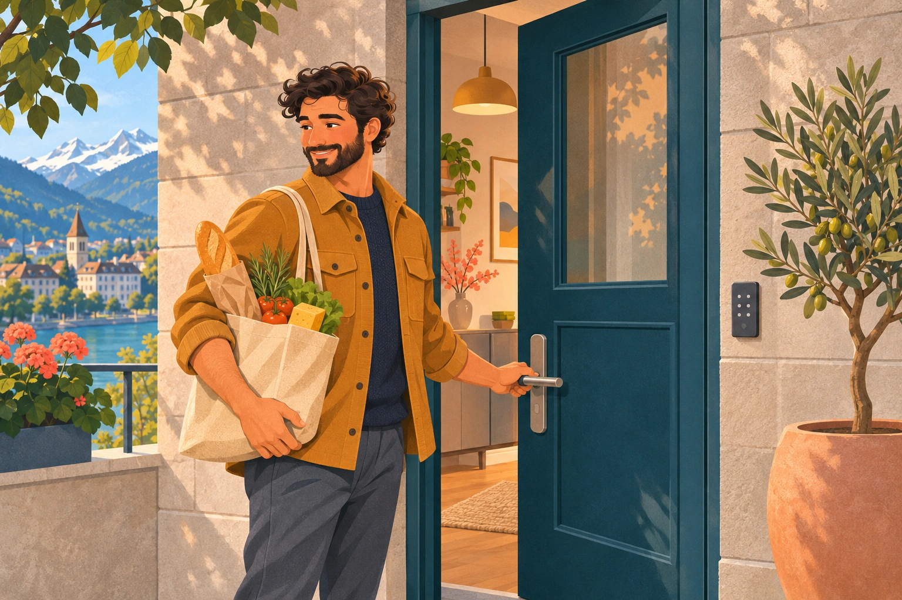
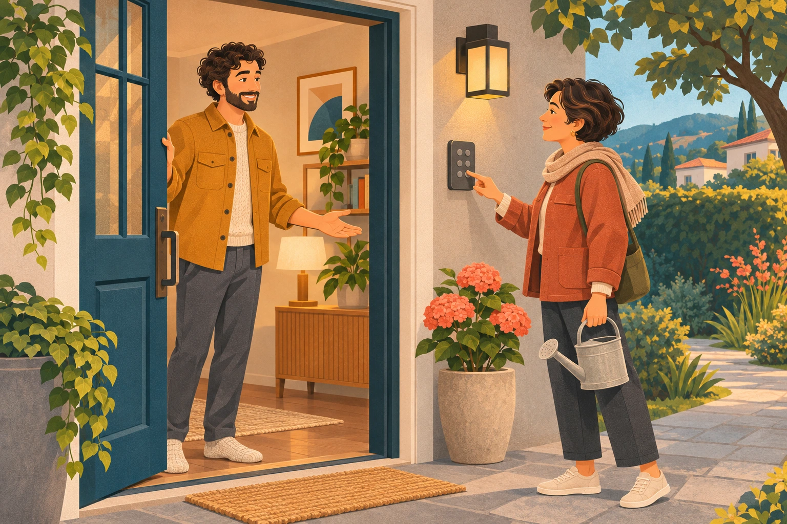
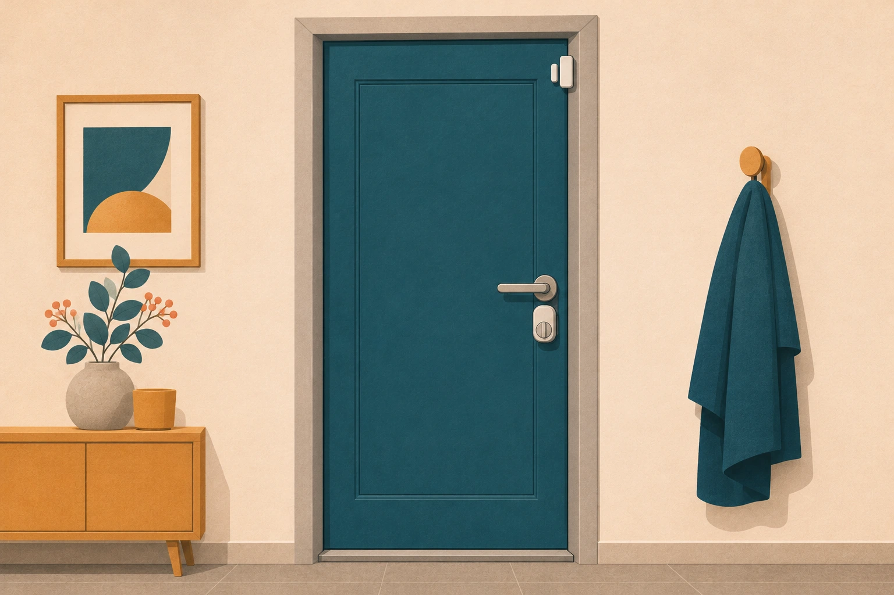
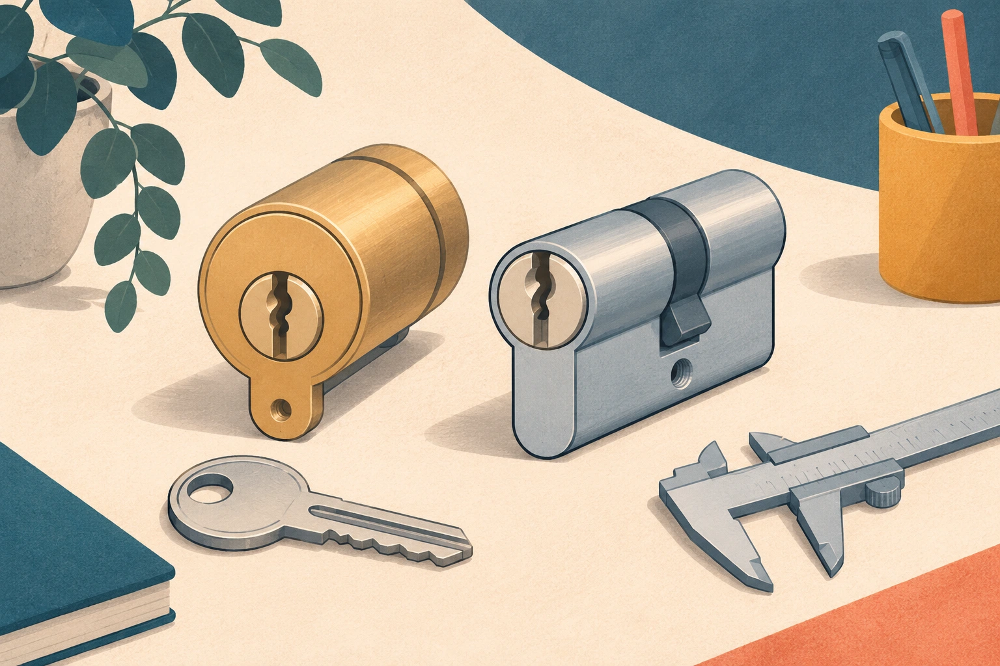
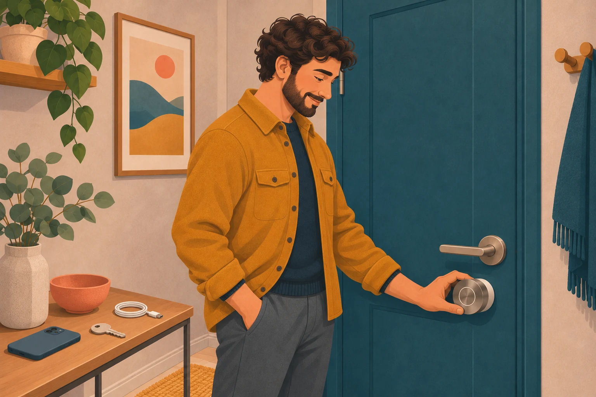

Die Haustür hat drei Aufgaben. Sie lässt die richtigen Leute herein, sie sagt Ihnen, ob sie zu ist, und sie sagt Ihnen, wer davorsteht. Ein Smart Home kann bei allen dreien helfen, und jede ist ein anderes Gerät: ein Schloss, ein Türkontakt und eine Türklingel.

Das ist der fünfte Beitrag der Serie über die Teile eines Smart Homes, nach [smartem Licht](/de/insights/smarte-beleuchtung-schweiz/), [Storen](/de/insights/smarte-storen-schweiz/), [Sensoren](/de/insights/smart-home-sensoren/) und [Heizung](/de/insights/smarte-heizung-schweiz/). Es sind dieselben Fragen wie zuvor: Was bringt es Ihnen, was sollten Sie vor dem Kauf prüfen, und wo liegen die ehrlichen Grenzen? Dieser Beitrag behandelt das Schloss und den Kontakt. Die Türklingel und die Frage, wer draussen steht, verdienen später in diesem Monat einen eigenen Beitrag.

<figure class="blog-post__figure">
  
</figure>

## Aufgabe eins: die richtigen Leute hereinlassen

Das Beste an einem smarten Schloss ist nicht, dass Sie die Tür mit dem Handy öffnen. Es ist, dass Sie jemandem Zugang geben können, ohne einen Schlüssel auszuhändigen.

- **Ein Code mit Zeitfenster für die Reinigung**, nur donnerstags am Vormittag gültig.
- **Ein Code für die Nachbarin,** die die Pflanzen giesst, während Sie weg sind, und den Sie ausschalten, wenn Sie zurück sind.
- **Zugang für einen Pflegebesuch,** etwa von der Spitex, den Sie im Protokoll sehen und beenden, wenn er nicht mehr nötig ist.
- **Familie ohne Schlüssel.** Kinder und Gäste verlieren einen Code nicht so wie einen Schlüssel.
- **Automatisches Öffnen** bei Ihrer Ankunft, wenn Sie es wollen, und wieder abschliessen, wenn Sie gehen.

Dafür brauchen Sie keinen Schlüsseldienst, und nirgends bleibt ein kopierter Schlüssel in einer fremden Schublade liegen.

<figure class="blog-post__figure">
  
</figure>

## Aufgabe zwei: Ist sie zu?

Ein Schloss weiss, ob der Riegel vorgeschoben ist. Es weiss nicht, ob die Tür geschlossen ist. Ein Türkontakt, der kleine Sensor aus dem [Beitrag über Sensoren](/de/insights/smart-home-sensoren/), schliesst diese Lücke. Zusammen beantworten sie die Frage, die wir uns alle im Auto stellen: Habe ich die Tür abgeschlossen? Ein guter Abendcheck lautet dann: «Die Haustür ist zu, aber nicht abgeschlossen» oder «noch offen», und schickt eine Nachricht oder schliesst für Sie ab.

<figure class="blog-post__figure">
  
</figure>

## Was es in der Schweiz zu kaufen gibt

Preise Stand 29. Oktober 2026. Sie ändern sich und die Verfügbarkeit schwankt, nehmen Sie die Angaben also als Richtwert.

**Nuki** ist ein hier bekannter Name. Digitec führt das Smart Lock Pro (4. Generation) in einer Version für den CH-Zylinder. Preis und Verfügbarkeit schwanken, prüfen Sie also vor der Bestellung. Es unterstützt Matter, hat ein eingebautes WLAN-Modul, automatisches Öffnen, bis zu 200 einzelne Zugangsrechte und ein Protokoll der Zutritte und wird ohne Schrauben und Bohren montiert. Das Home-Assistant-Team hat im Juli 2025 selbst drei Nuki-Schlösser getestet und zertifiziert: das Smart Lock Go, das Pro und das Ultra. Sie verbinden sich über Matter over Thread, arbeiten lokal und brauchen kein Cloud-Konto. Die Nuki-App ist für die Einrichtung nötig, und der Fernzugriff später braucht entweder die Nuki-App oder Home Assistant Cloud.

**Aqara** verkauft das Smart Lock U200 für EUR 189.99 im EU-Shop. Es hat Fingerabdruck, PIN (auch temporäre Gästepasswörter), NFC-Karten und Apple Home Key und spricht Thread, Bluetooth und Matter over Thread. Aqara gibt an, dass das Schloss den eigenen M3-Hub braucht. Es ist für Euro-Profilzylinder ausgelegt, nicht für Schweizer, prüfen Sie die Kompatibilität mit Ihrem Zylinder also vor dem Kauf.

**UniFi Access** ist eine andere Liga. Das ist das Zutrittssystem von Ubiquiti: verkabelte Geräte, die über das Netzwerkkabel laufen, mit einer Gegensprechanlage an der Tür, einem Hub pro Tür und elektrischen Türöffnern oder Magnetschlössern statt eines smarten Zylinders. Schweizer Shops führen die Video-Gegensprechanlage, das Innengerät, den Tür-Hub und die Türöffner. Hat ein Haus oder Gebäude mehrere Eingangstüren, ein Garagentor, Briefkästen, eine Klingel und vielleicht eine Magnettür, bindet ein solches System alles unter einer gemeinsamen Zutrittsverwaltung zusammen, und es ist viel ausgereifter und sicherer als die Zylinder oben. Es braucht Planung und Verkabelung, ist also kein Wochenendprojekt. Ich habe es noch nicht ausprobiert. Ich möchte es für mich und meine Nachbarn einbauen, da wir in Doppeleinfamilienhäusern mit gemeinsamer Garage wohnen, deshalb werde ich es gründlich recherchieren, und es verdient einen eigenen Beitrag.

## Eines vorab prüfen: Passt Ihr Zylinder?

Schweizer Zylinder sind nicht immer dieselben wie die europäischen. Prüfen Sie vor dem Kauf eines Schlosses den Zylindertyp, ob er eine Notfunktion hat (er lässt sich von aussen mit dem Schlüssel öffnen, auch wenn innen ein Schlüssel steckt) und, wenn Sie mieten, ob Sie ihn überhaupt wechseln dürfen. Fragen Sie zuerst Ihre Vermieterschaft oder die Verwaltung.

<figure class="blog-post__figure">
  
  <figcaption>Vereinfachte Darstellung; vor dem Kauf den tatsächlichen Zylinder und die Kompatibilität laut Hersteller prüfen.</figcaption>
</figure>

## Ehrliche Grenzen

**Das Schloss darf Sie nie einsperren.** Die Tür muss sich von innen immer öffnen lassen, mit einer Klinke oder einer Drehung, ganz gleich, was Strom, Netz oder App tun. Und für den Fluchtweg gilt: Kein smartes Schloss ist ein Grund, das Hinausgehen zu erschweren.

**Tastatur-Codes und die Cloud.** Das ist eine echte Lücke. Es ist noch nicht möglich, die Codes einer Nuki-Tastatur lokal aus Home Assistant zu verwalten. Eine Anfrage im Entwicklerforum von Nuki vom März 2026 verlangt genau das, über die lokale Schnittstelle oder MQTT. Bis es so weit ist, läuft das Anlegen oder Löschen eines Codes mit Zeitfenster über Nukis eigene App oder die Cloud. Das Schloss selbst arbeitet lokal. Die Codeverwaltung nicht. Wenn Codes mit Zeitfenster Ihr Hauptgrund für den Kauf sind, fragen Sie, wie sie verwaltet werden, bevor Sie entscheiden.

**Wieder Batterien.** Aqara nennt bis zu sechs Monate beim Akkupack bei etwa acht Entriegelungen am Tag. Nukis Go nutzt vier AA-Batterien. Was immer Sie wählen: Planen Sie eine Warnung bei schwacher Batterie ein und bewahren Sie einen mechanischen Schlüssel an einem sicheren Ort auf.

<figure class="blog-post__figure">
  
</figure>

**Verlassen Sie sich nicht nur aufs Handy.** Ein leeres Handy sollte keine ausgesperrte Familie bedeuten. Ein Code, ein Fingerabdruck oder ein Schlüssel sollte immer auch funktionieren.

**UniFi Access ist ein Projekt, kein Einkauf.** Es braucht ein verkabeltes Netzwerk mit Strom über das Kabel, einen Plan für jede Tür und eine Entscheidung für jeden elektrischen Türöffner oder jedes Magnetschloss: Bleibt es bei Stromausfall verriegelt oder öffnet es? Wie Sie sich auch entscheiden, die Tür muss sich von innen weiterhin öffnen lassen. Teilen sich mehrere Haushalte Türen, wie wir die Garage, müssen sich alle einig sein, wer die Zutrittsrechte verwaltet. Teile, die am Netzstrom hängen, gehören in die Hände einer Elektrofachperson. Ich habe es noch nicht gebaut, verstehen Sie diesen Abschnitt also als die Fragen, die ich stellen werde, nicht als Empfehlung.

**Es ist keine Alarmanlage.** Ein smartes Schloss ist so stark wie die Tür und der Zylinder, an dem es sitzt. Es bringt Komfort und ein Protokoll, keine stärkere Tür.

## So würde ich beginnen

1. **Mit dem Türkontakt beginnen.** Er kostet wenig, und «Ist die Haustür zu?» ist die Frage, die Sie schon stellen.
2. **Das Schloss dazunehmen,** sobald Sie wissen, dass Ihr Zylinder passt und, wenn Sie mieten, Ihre Vermieterschaft zustimmt.
3. **Einen Code mit Zeitfenster anlegen** für einen echten Fall, etwa die Reinigung, und ausprobieren, wie es sich anfühlt.
4. **Die schlechten Fälle testen.** Leere Batterie, kein Internet, kein Handy. Es muss immer einen Weg hinein geben.

In einem Konihaus-Zuhause melden das Schloss und der Türkontakt lokal an die Greenhub, und der Abendcheck «Ist die Tür noch offen?» läuft ohne Internet. Wo die Codeverwaltung noch die Cloud des Schlossherstellers braucht, sage ich es Ihnen vor dem Kauf. Wenn Sie die nächsten Beiträge der Serie nicht verpassen wollen, melden Sie sich unten für den Konihaus-Blog-Newsletter an.

---

**Ein smartes Schloss für Ihr Zuhause?** [Sprechen Sie mit Koni](https://konihaus.ch/#contact). Das erste Gespräch ist kostenlos und unverbindlich.
