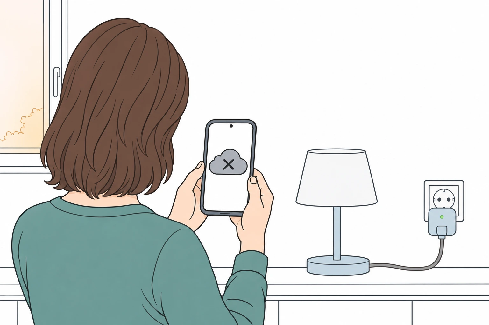
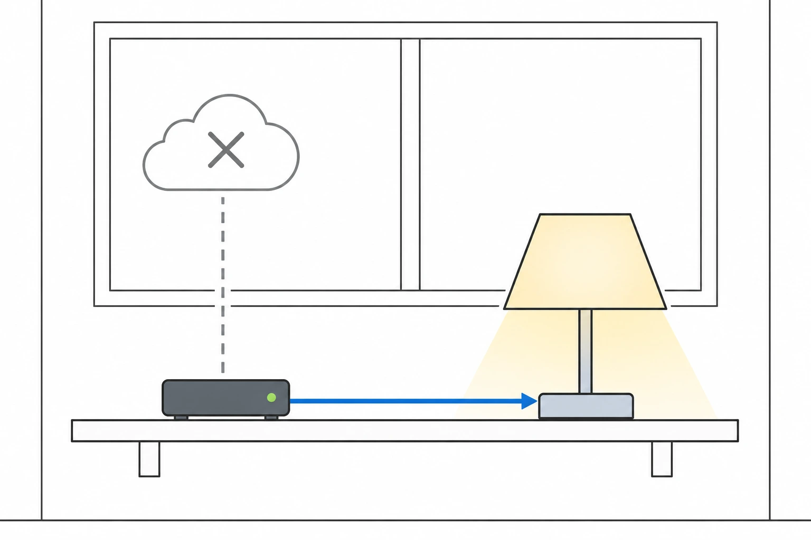

One morning the app says: "This service has ended." The lamps are where they were, the sockets are still in the wall. But what made them smart was never in your house. It was on a server, and the company that ran it has stopped.

This is not a thought experiment. It has happened often enough that there are clear patterns. Here are three recent cases.

<figure class="blog-post__figure">
  
</figure>

## Three real shutdowns

- **Gigaset, March 2024.** Insolvency proceedings against the German company were opened on 29 January 2024. A buyer took over the telephone business, but nobody took the smart home business, and the company said insolvency law did not allow it to keep the services running ([Gigaset](https://service.gigaset.com/es/support/solutions/articles/75000121662-why-is-the-gigaset-smart-home-system-no-longer-usable-)). On 29 March 2024 the cloud was switched off. According to the Swiss trade magazine [IT Reseller](https://www.itreseller.ch/Artikel/100542/Gigaset_beendet_Smart-Home-Unterstuetzung.html), the smoke detector was the only product that kept working.
- **Belkin Wemo, January 2026.** Belkin announced in July 2025 ([TechCrunch](https://techcrunch.com/2025/07/10/belkin-ends-support-for-most-wemo-devices-and-its-wemo-app)) that it would end the Wemo cloud on 31 January 2026. After that date the app, remote access and the Alexa and Google Assistant connections stopped, and new devices could no longer be set up through the app. Devices that had been set up with Apple HomeKit before the deadline kept working locally, and so did the Thread models ([Belkin](https://www.belkin.com/support-article/?articleNum=335419)).
- **Bose SoundTouch, May 2026.** Bose announced the end of cloud support in October 2025, postponed the date after complaints, and switched the cloud off on 6 May 2026. Presets and the music-service search in the app stopped, and there are no more security updates. Bluetooth, AirPlay on some models, Spotify Connect and the AUX input keep working, and Bose has published the technical documentation of the interface ([PC-WELT](https://www.pcwelt.de/article/3032259/bose-soundtouch-support-ende-tipps.html)).

One more, in a single sentence, because it is a US brand: in April 2022 the US company Insteon went silent without warning its customers, and the physical switches kept working while the automation did not ([The Register](https://www.theregister.com/2022/04/19/insteon_cloud_shutdown/)).

## Why it happens

The three stories end in different ways: a company goes insolvent, a company decides a product line is no longer worth the cost, a product simply gets old. The root is always the same. The device needs the manufacturer's server to do its job, and a server costs money every month. When the money stops, the service stops, and the hardware in your wall is still perfectly fine.

## What kept working

Look at the lists again. What survived was whatever talked locally: the Wemo devices set up with HomeKit, the Thread models, the Bose speakers over Bluetooth or a cable, the Insteon wall switches, the Gigaset smoke detector. The part that depended on the cloud went, the part that could do its job on its own stayed.

That is the rule I design by.

<figure class="blog-post__figure">
  
</figure>

## What I do differently

In a Konihaus home, the brain is a small hub in your own house running Home Assistant. Devices talk to it locally, on open standards such as Zigbee, and the automations run there. There is no account with a manufacturer that the home depends on. I wrote about the reasoning in [No Vendor Lock-In](/en/insights/no-vendor-lock-in/) and in [Will It Still Work in Ten Years?](/en/insights/future-proof/).

Home Assistant itself shows how a cloud can be done. Its optional online service, until now called Home Assistant Cloud, is being renamed Home Assistant Link: the rename was announced on 2 October 2026 and is planned for the December release. Link provides remote access, the connection to Alexa and Google Home, online speech recognition, encrypted backups and human support. The project says plainly that the home keeps working without it, and keeps working if you cancel the subscription ([Home Assistant](https://www.home-assistant.io/blog/2026/10/02/big-tech-ruined-the-cloud-so-were-renaming-ours/)).

That's the order I want: cloud as an extra you can switch off, not as the foundation.

## Honest limits

- **Local doesn't mean forever.** Hardware fails, and a company that disappears also stops sending updates. Bose says it won't provide security updates after May 2026, which is why a device like that belongs on a private network.
- **Some things need the internet by nature.** A weather forecast, a music service, a big-tech voice assistant: if that service goes, that function goes. The lights, the heating and the locks should not go with it.
- **An optional service is still a service.** If you use remote access through a company's service, it's worth knowing the alternative. In a Konihaus home, remote access runs over an encrypted VPN.
- **I can't tell you which company will still exist in ten years.** Nobody can. That's exactly why the question is how much breaks when one doesn't.

## Five questions before you buy

1. **Does it still work without internet,** at least the basics?
2. **Does it need an account with the manufacturer** to work every day?
3. **Does it speak an open standard** such as Zigbee, Matter or Thread, so another hub could take over?
4. **Where does the brain run,** in your house or on the manufacturer's server?
5. **What happens if the company disappears?** If the honest answer is "it stops", think twice, especially for locks, smoke alarms and heating.

<figure class="blog-post__figure">
  
</figure>

## If you already own cloud-only devices

No need to throw anything away today. Find out which functions still work without the cloud, use the device as long as it works, and replace things step by step. Start with the ones that matter for safety: door locks, smoke and water alarms, heating. If you want a second opinion on what you have at home, I'm happy to look at it with you.

---

**Not sure which of your devices depend on a server?** [Talk to Koni](https://konihaus.ch/#contact). The first conversation is free, with no obligation.
