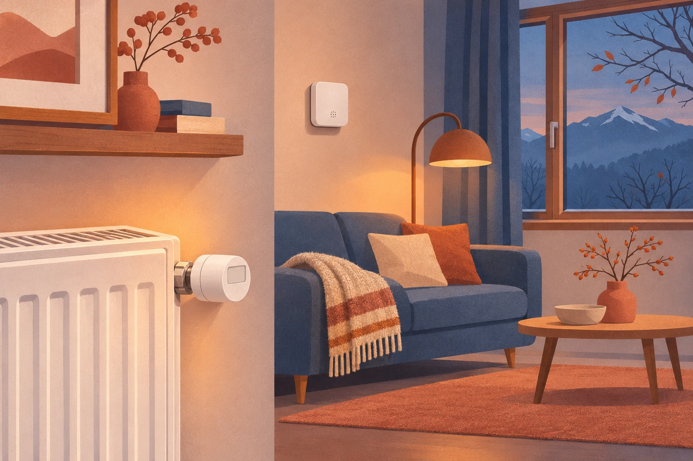
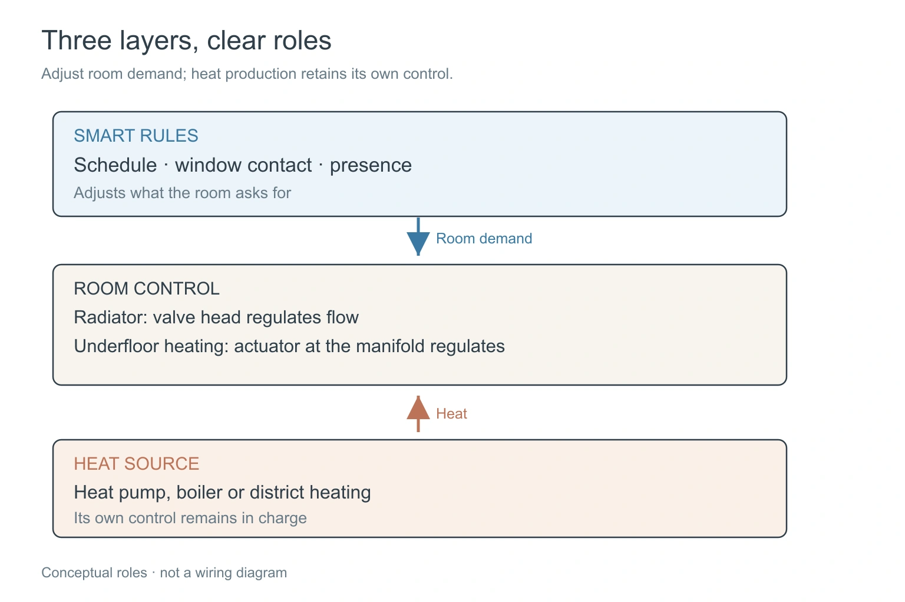
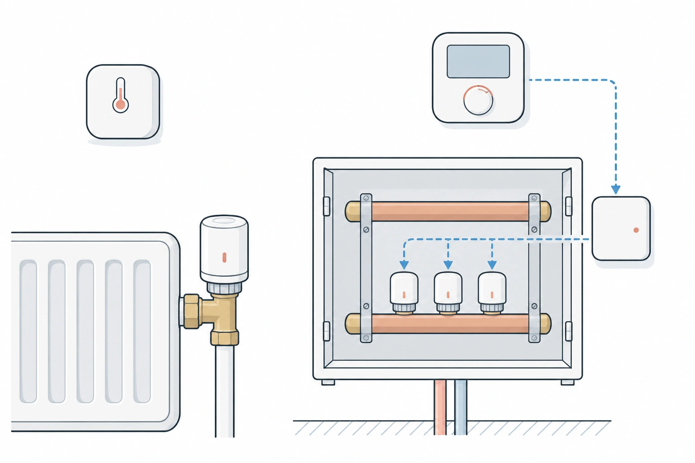
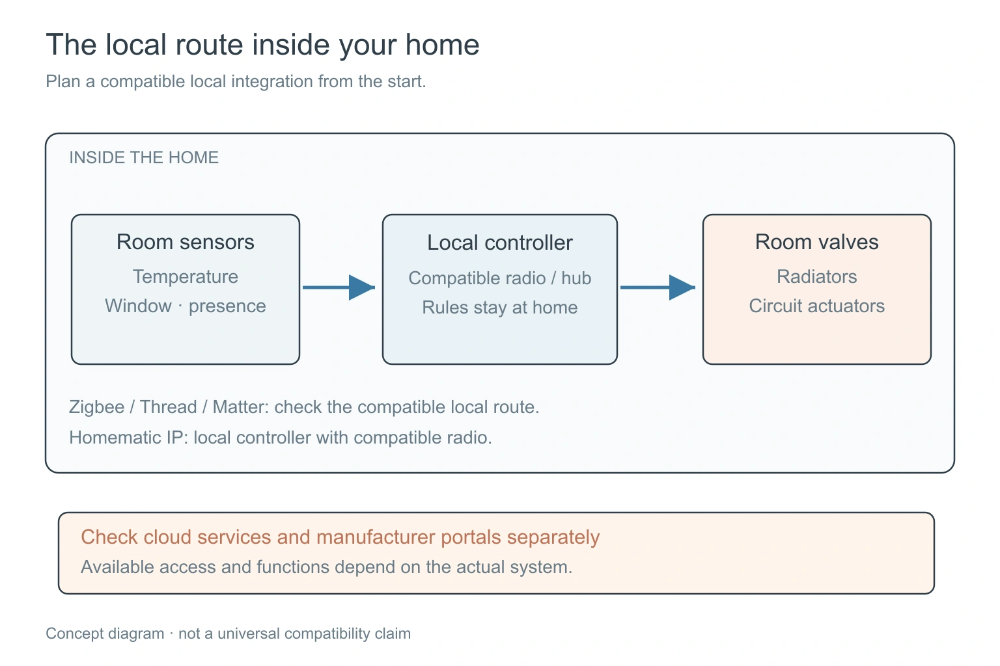
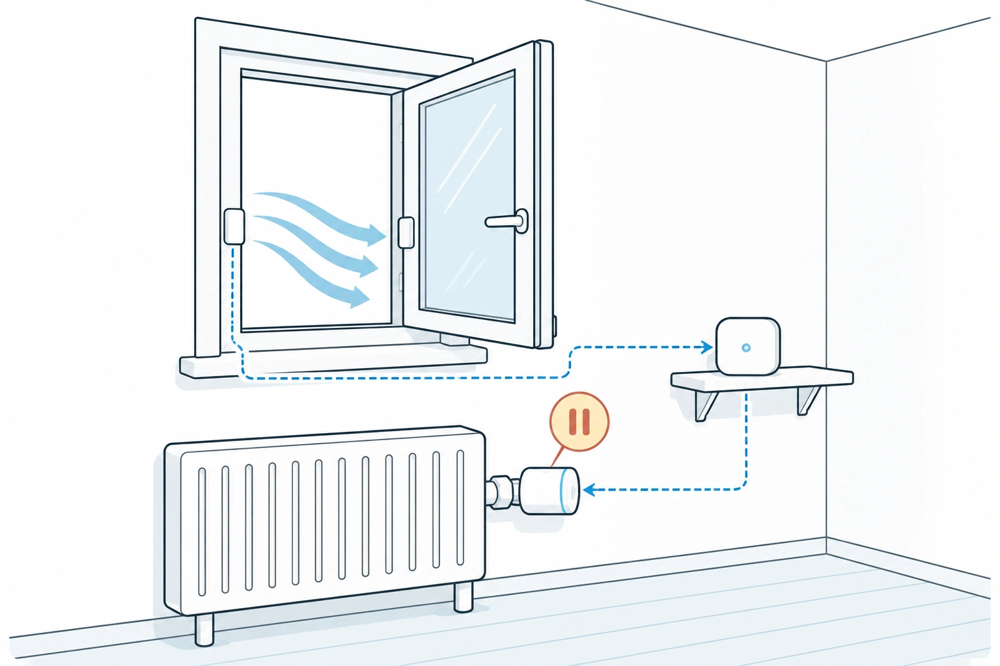
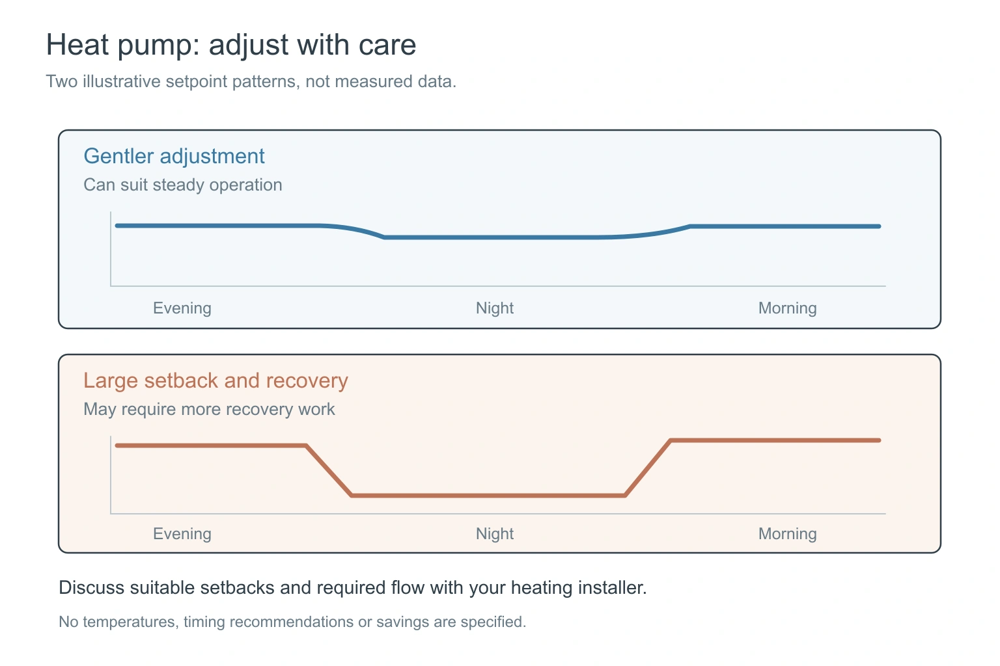

Heating is where a smart home can quietly pay for itself, and where it can quietly make things worse. The heating is the biggest energy user in most Swiss homes, so small mistakes are expensive. And it is the area with the most confusion, because three different devices all claim to be in charge: the room thermostat, the radiator valves and the heat pump itself.

This is the fourth post in the series on the parts of a smart home, after [smart lights](/en/insights/smart-lights-switzerland/), [smart blinds](/en/insights/smart-blinds-switzerland/) and [sensors](/en/insights/smart-home-sensors/). Same questions as before: what does it do for you, what should you check before buying, and where are the honest limits. I won't promise savings figures. They depend on your building, your heating and how you live.

<figure class="blog-post__figure">
  
</figure>

## Who is in charge?

Think of it as three layers.

**The heat source** makes the warmth: a heat pump, a gas or oil boiler, district heating. It has its own control, usually based on the outdoor temperature.

**The room** decides how much warmth it wants. In a home with radiators, that is the radiator valve, the small head on each radiator that opens and closes the flow. With underfloor heating, the wall thermostat only measures and asks. What actually regulates is the motorised valve (actuator) on the heating manifold, usually in a cupboard, one per heating circuit. If you replace those valves with smart ones, such as Homematic IP, any room sensor, schedule or rule in your smart home can control each circuit, not only the wall thermostat.

**The smart part** sits on top. It knows the schedule, whether a window is open, whether anybody is home, and what the real temperature in the room is.

A good smart heating system doesn't replace the heat source. It tells the rooms when to ask for less, and it keeps its hands off the part that the heating installer set up for a reason.

<figure class="blog-post__figure">
  
</figure>

## What you can buy in Switzerland

Prices as of October 2026, Homematic IP as of 3 November 2026. They change, so treat them as a guide.

**tado** is the best-known name. Digitec lists the Smartes Heizkörperthermostat Starter Kit X, which includes the Bridge X, at CHF 182. One thing to know before you buy: in September 2025 tado announced limits on how often outside systems such as Home Assistant may ask its cloud for data. The free tier is 100 requests a day for things local access can't handle, and a paid Auto-Assist subscription raises that to 20,000 a day (2.99 EUR a month or 29.99 EUR a year, as reported at the time). Simple reads such as temperature and humidity are meant to go through local routes: HomeKit for the older V3 and V3+ devices, Matter for the X generation. So tado is workable in a local-first home, but you should plan for that route from the start.

**Netatmo** sells a valve as an add-on to its own thermostat and starter pack. The additional valve costs about CHF 80 from a marketplace seller on Digitec, with offers from CHF 49. Features include automatic open-window detection and a schedule built from five questions about your daily routine. User ratings include tags like "high battery consumption", so look at the reviews for your case.

**Aqara** makes the Radiator Thermostat E1 at CHF 59.90 on Digitec. It runs on batteries and pairs with Aqara's door and window sensor for open-window detection. A Computer Bild review calls the built-in detection "hardly reliable", which is a reason to add the separate window sensor. Home Assistant users run it over Zigbee, without Aqara's own app.

**Homematic IP** is the one to know for underfloor heating. The [Underfloor Heating Controller, 12-way](https://www.galaxus.ch/en/s2/product/homematic-ip-underfloor-heating-controller-12-way-heater-accessories-11154706) (CHF 164 on Galaxus) sits at the manifold and drives up to 12 heating circuits. Each circuit gets a motorised actuator: the [eQ-3 actuator](https://www.galaxus.ch/en/s2/product/eq-3-actuator-thermostats-12256472) costs CHF 18.50 per piece and clicks onto common valves with an M30 x 1.5 thread, without tools. You have two ways to get the room temperature. Either Homematic IP wall thermostats, which are sold separately, or no thermostat at all: a simple smart thermometer in each room plus a window contact, and your smart home decides when a circuit opens or closes. Homematic IP uses its own 868 MHz radio, not Zigbee, so your smart home needs a small radio stick to talk to it, for example the Homematic IP USB stick with OpenCCU. The controller sits on the building's heating installation and mains supply, so have a heating installer or electrician connect it, and ask your landlord first if you rent.

<figure class="blog-post__figure">
  
</figure>

For a heat pump or boiler, the cheapest useful addition is not a valve at all. It is a **separate room temperature sensor**, as in the [sensors post](/en/insights/smart-home-sensors/), which gives you a second opinion on what the heating thinks the room temperature is.

## One thing to check before anything else: where the data goes

As with the other device groups, the brand matters less than the path.

- **Local first.** Zigbee, Thread and Matter devices report to your own system, even when the internet is down. Homematic IP can too, with a local controller such as OpenCCU.
- **Cloud with limits.** Some heating systems only talk to the manufacturer's server, and the server decides what outsiders may ask, and how often. The tado announcement above is a good example.
- **Heat pump portals.** Many heat pump makers give you an app and a portal, but little or no local connection. Ask before you buy what data you can reach locally, and what you can only see in the maker's cloud. This is the part most likely to surprise you.

I wrote about why this matters in [no vendor lock-in](/en/insights/no-vendor-lock-in/).

<figure class="blog-post__figure">
  
</figure>

## What smart heating does well

- **Open-window detection.** The valve closes when the room temperature falls quickly, or a window contact opens. Heat doesn't go out the window while you air the room.
- **Schedules that follow your life.** Warm in the morning, lower while nobody is home, warm again before you return. Presence from a phone or a sensor makes this more reliable than a fixed timer.
- **A room-by-room view.** You see which rooms are cold, which are overheated, and which valve is stuck.
- **A holiday home that doesn't freeze.** A minimum temperature and a message if it falls below it, as in the [holiday home frost watch](/en/insights/holiday-home-frost-watch/).

<figure class="blog-post__figure">
  
</figure>

## Honest limits

**A heat pump is not a boiler.** It works best with steady, low flow temperatures. Setting valves to drop sharply at night and then reheating every morning can make it work harder, not less. The rule of thumb is gentler changes and not every valve closed at once. Your heating installer knows your system, so ask them before you add night setbacks.

<figure class="blog-post__figure">
  
</figure>

**Not every radiator fits.** Valve adapters matter, and underfloor heating needs different devices from radiators (see Homematic IP above). Check the thread and the adapters in the box.

**Batteries again.** Valves open and close all day, and that uses power. Plan on regular battery checks, and expect that some products use more than others.

**Savings are not guaranteed.** A smart valve helps most in rooms that were heated for nobody. In a home that is already used steadily, the gain can be small. For the bigger picture, see [energy efficiency](/en/insights/energy-efficiency/).

## Your own heating, or one for the whole building

Whether turning the heat down saves you money depends on who pays for it.

**Your own heating** (a house, your own boiler or heat pump): every degree you save comes off your own bill. This is where valves and schedules pay off most directly.

**One heating for a whole block of flats:** the heat is made in one place, and the cost is split between the flats. How it is split decides whether your own room regulation changes your invoice. With consumption-based billing (in German VHKA, with heat cost allocators on the radiators or heat meters per flat), what you use counts, so turning the heat down in your rooms lowers your share. If the cost is split by floor area, your own habits barely change the bill, and the gain is comfort. In Switzerland, [new buildings and complete heating replacements with five or more units must be equipped for consumption-based billing](https://www.endk.ch/de/fachleute-1/vollzugshilfen/muken-2014/ftw-simplelayout-filelistingblock/EN-113-d_VHKA_2018Dez.pdf), but the cantons differ, and several have dropped the duty to retrofit existing buildings. A [2022 SRF report](https://www.srf.ch/sendungen/kassensturz-espresso/kassensturz/steigende-heizkosten-zwei-drittel-aller-mieter-zahlen-fuer-waermeliebende-nachbarn-mit) quoted an industry estimate that only about one in three multi-family buildings bills purely by consumption, and cited studies in which tenants used about 15 percent less heating energy after meters were installed.

Your annual utility statement shows which model applies to you. Ask your landlord or the administration how your building is billed, and whether the meters can be read remotely. If you rent, swapping radiator valve heads is fine, as in [smart home for renters](/en/insights/smart-home-for-renters/). The underfloor manifold belongs to the building, so ask first.

## How I'd start

1. **Start with the rooms that are heated but empty.** Spare room, office, a guest room.
2. **Add a room sensor** where the heat pump's reading and the real room don't match.
3. **Pick devices with a local route.** Zigbee, Thread, Matter, or Homematic IP with a local controller, not only a cloud account.
4. **Leave the heat source alone** until you know how it behaves, and ask the installer about night setbacks.

In a Konihaus home, valves and room sensors report to the Greenhub, locally, and the heat pump's own control stays in charge of making the heat. The next post covers locks and doors: the front door's three jobs. If you don't want to miss it, sign up for the Konihaus Blog newsletter below.

---

**Thinking about smart heating for your home?** [Talk to Koni](https://konihaus.ch/#contact). The first conversation is free, with no obligation.
