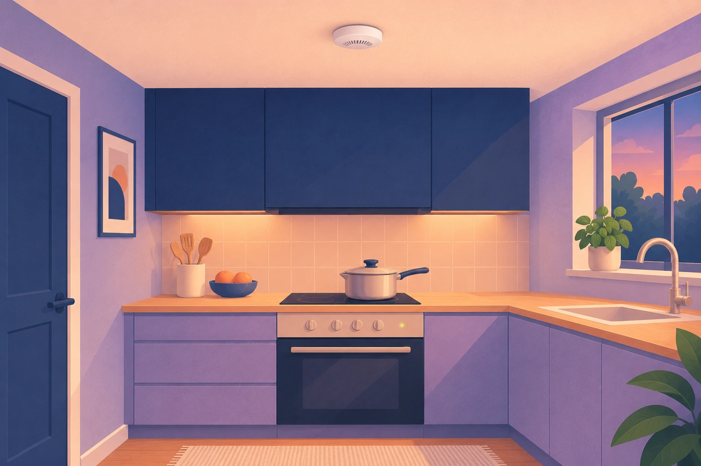

Almost everything else in a smart home is about comfort. Smoke, CO and gas alarms are about something else, and they follow one rule that nothing else in this series has to follow: **the alarm never depends on the hub, the app, the internet or me.** If the Wi-Fi is down at 3 a.m., the siren still has to wake you.

This post continues the series on the parts of a smart home, after [smart lights](/en/insights/smart-lights-switzerland/), [blinds](/en/insights/smart-blinds-switzerland/), [sensors](/en/insights/smart-home-sensors/), [heating](/en/insights/smart-heating-switzerland/) and [locks](/en/insights/smart-locks-switzerland/). I promised it in the sensors post. Same questions as before: what does it do for you, what should you check before buying, and where are the honest limits.

## The rule: the siren is the product

A smoke alarm earns its place by making noise in your home, on its own. Everything "smart" is an extra on top: a message to your phone when you are away, lights that come on, a warning when the battery runs low. The extra is welcome, but it is never the part that protects you.

The same lesson came out of the [server shutdowns](/en/insights/manufacturer-switches-off-server/): when Gigaset's cloud went off in March 2024, the smoke detector was the only product that kept working ([IT Reseller](https://www.itreseller.ch/Artikel/100542/Gigaset_beendet_Smart-Home-Unterstuetzung.html)). That is how a safety device should behave.

<figure class="blog-post__figure">
  
</figure>

## What the Swiss rules say

Fitting smoke alarms is voluntary in Switzerland. The VKF, the association of the cantonal building insurers that is responsible for the Swiss fire protection regulations, sees no need to make them mandatory, but recommends them. According to [SRF](https://www.srf.ch/news/schweiz/toedliche-hausbraende-wieso-es-in-der-schweiz-keine-rauchmelderpflicht-gibt), about 90 percent of fire deaths are caused by smoke inhalation, and the VKF advises fitting an alarm centrally in the apartment and in every bedroom, with older buildings benefiting most. It also says it matters that the device is tested to **EN 14604**, the standard for smoke alarms. The BFB adds that only devices certified to EN 14604 may be sold in Switzerland ([BFB](https://www.bfb-cipi.ch/brandverhuetungs-tipps/detail/rauchwarnmelder)).

The BFB, the Swiss fire prevention agency, counts about 11,000 building fires a year with damage of about CHF 330 million, and notes that people over 80 have a much higher risk of dying in a fire ([BFB](https://www.bfb-cipi.ch/fileadmin/user_upload/bfbcipi/Bilder/Kampagnen/2025-1_Pro_Senectute/Pro_Senectute_Ratgeber_Brandverhuetung.pdf)). So the missing obligation is no reason to skip them. If you rent, ask your landlord what is already installed before you buy; my post on [smart homes for renters](/en/insights/smart-home-for-renters/) covers the rest.

## Where to put them

The BFB's rule of thumb is one alarm per 60 m², with several in larger rooms. It lists living rooms, hallways, stairwells, basements, heating rooms and rooms where lithium-ion batteries are charged as good places, and for a multi-storey house at least the hallway or entrance area, the children's rooms and the bedrooms on each floor ([BFB](https://www.bfb-cipi.ch/brandverhuetungs-tipps/detail/rauchwarnmelder)). The fire brigade of the city of Bern adds the office and the laundry room, and names e-bikes, e-scooters and laptops as reasons to cover a charging spot ([Feuerwehr Bern](https://www.bern.ch/politik-und-verwaltung/stadtverwaltung/sue/schutz-und-rettung-bern/feuerwehr-der-stadt-bern/publikationen-merkblaetter/tipps/flyer-brandschutztipps.pdf/download)). Mount an alarm in the centre of the ceiling, at least 0.5 m from walls and lamps, and not in a room that can get colder than 0 °C or warmer than 40 °C (the Bern fire brigade says not below 5 °C).

**Not in the kitchen.** Steam and cooking fumes set off smoke alarms. The BFB and the Bern fire brigade recommend a **heat alarm** there, which reacts to temperature instead. If you still want a smoke alarm near the kitchen, keep it at least 2 m from the stove, oven and steamer.

In a larger or multi-storey home the BFB recommends **radio-linked alarms**: when one sounds, all of them sound, because a single siren may not be heard in every room.

<figure class="blog-post__figure">
  
</figure>

## What to buy

Three checks matter more than the brand:

1. **EN 14604 on the device.** The BFB says only alarms certified to this standard may be sold in Switzerland, so a device without it is the wrong one.
2. **A sealed battery rated for 10 years.** You never open it, and when the rated life ends, you replace the whole alarm. A plain example is the Ei Electronics Ei650: EN 14604, built-in lithium battery rated for 10 years, 85 dB(A) siren, about CHF 24 at [Galaxus](https://www.galaxus.ch/de/s4/product/ei-electronics-ei650-rauchmelder-gefahrenmelder-8027933). It is not smart, and it doesn't need to be.
3. **It sounds with the hub unplugged.** For any alarm that talks to a smart home, this is the test I do first.

The BFB also asks you to press the test button once a month and to replace the whole alarm every 10 years.

If you want one alarm that also talks to a smart home, the ABUS Prefira Smart is an example that keeps the rule. According to ABUS it is tested and certified to EN 14604 (by KRIWAN) and is stand-alone, with a built-in 85 dB(A) siren, and it reports over Matter over Thread, which needs a Thread border router at home. The trade-offs: its battery is a replaceable CR123A rated for up to 5 years, not a sealed 10-year one, and it does not link by radio to other alarms ([ABUS](https://www.abus.com/ch_de/Privat/Brandschutz-Gefahrenmelder/Brandschutz/Rauchwarnmelder/Rauchmelder/Rauchwarnmelder-PREFIRA-SMART)). Check both points on any model you consider.

<figure class="blog-post__figure">
  
</figure>

## What the smart part adds

Once the alarm works on its own, the hub can add the things a siren cannot do:

- **A message to your phone** when you are away, and to a family member or neighbour if you want.
- **Lights on** in the hallway and on the way to the door.
- **A warning when a battery is low** or an alarm has gone silent, so you don't find out the hard way.
- **Help for people who need more than a siren.** The BFB points out that networked alarms can pass the alarm on, to building services, relatives or a 24-hour emergency call centre, and that people with impaired hearing need a flashing light and a vibration alarm.

The limits are real. The hub does not call the fire brigade, a message can arrive late or not at all, and it takes you a few seconds to read it. If you are away and the alert looks real, call 118. And one more rule: **no automation may ever silence or switch off an alarm.**

## CO: only where something burns

Carbon monoxide is colourless and odourless, it irritates neither eyes nor airways, and so there is no warning sign. First symptoms are headache, nausea and dizziness, easily mistaken for a cold, and the time to unconsciousness is short ([Tox Info Suisse](https://www.toxinfo.ch/gefahr_kohlenmonoxid_beim_grillieren_in_innenraumen_en)).

The sources that matter in a home are a wood stove, a fireplace or a gas appliance, and a charcoal grill used indoors, which Tox Info says is dangerous even with windows and doors open. If none of these is in your home, a CO alarm has little to do. If one is, get an alarm made for homes (the standard is [EN 50291-1](https://iteh.es/catalog/standards/clc/857a4afa-7190-4005-9f5d-a53f9f217964/en-50291-1-2018), which expressly excludes car parks and industrial sites), place it as the manufacturer describes, and treat it like a smoke alarm: it sounds on its own. If it goes off, or several people feel unwell at once, get into fresh air and call 144. The free poison helpline 145 gives advice around the clock.

## Gas: only with a gas connection

Gas heats about 17 percent of residential buildings in Switzerland, against 33 percent for oil and 25 percent for heat pumps (Federal Statistical Office, data for 2025, [published 15 September 2026](https://www.bfs.admin.ch/de/newnsb/xrhcMB8jXvge)). So most homes don't need a gas alarm. If you have a gas boiler or a gas hob, a detector for natural gas and LPG made for homes ([EN 50194-1](https://iteh.es/catalog/standards/clc/0d28dbf1-af55-4752-8254-913d87120a39/en-50194-1-2009); the standard excludes industrial and commercial use) is worth considering for the times when nobody is awake to smell it.

I keep the smart part modest here. A motorised valve that shuts the gas supply is plumbing work for a licensed installer, not a weekend project, and I would not wire one into an automation.

If you smell gas, the cantonal advice (this is the version from the canton of Solothurn, [Kanton Solothurn](https://so.ch/verwaltung/volkswirtschaftsdepartement/amt-fuer-militaer-und-bevoelkerungsschutz/katastrophenvorsorge/verhaltensanweisungen/gasgeruch/)) is: no flames, no switches, no phone inside the building; open windows and doors; don't switch on the cooker hood or a fan; close the gas valves on the appliances and at the meter; warn your neighbours by knocking, not ringing; leave the building; and call from outside, either your gas supplier's emergency service or the fire brigade on **118**. The call is free even if it turns out to be a false alarm. Put your gas supplier's emergency number into your phone now, because the supplier differs from place to place.

## What about a shared underground garage?

Household smoke and CO alarms are made for living spaces. The standard for home CO alarms excludes car parks, and the BFB's temperature limits for smoke alarms (nothing below 0 °C or above 40 °C) can be a problem in a garage that isn't heated. So don't simply fit a bedroom alarm in a garage.

What the VKF guideline for parking garages does ask for is firefighting equipment: suitable extinguishers that are easy to see and reach, placed in escape routes or near the exits, with no more than 40 m to the nearest one. That section is written for car parks over 150 m² ([VKF](https://services.vkg.ch/rest/public/georg/bs/publikation/documents/BSPUB-1394520214-1884.pdf/content)). The BFB adds that extinguishers must stay ready for use and must not be covered, and that a garage is not a store room: besides the car, one set of tyres, vehicle-related material and sports equipment may be kept ([BFB](https://www.bfb-cipi.ch/brandverhuetungs-tipps/detail/pflichten-fuer-hauseigentuemer-und-mieter)).

The provisions I would point to cover extinguishers and smoke extraction; the guideline doesn't set a detector or CO sensor requirement for a small garage. What applies to your building is for the fire authority and your building insurer to say, so ask your property manager or the insurer instead of improvising. A heat alarm in the garage is something to discuss with them, not a rule I can point to.

## Honest limits

- **This is general guidance, not a fire-safety inspection.** Whether a building needs a proper fire alarm system depends on its use and size. The VKF guideline lists the types, and the fire authority decides in doubtful cases, as the Zurich building insurer GVZ describes in its [directive](https://www.gvz.ch/_file/271/weisung-20-07-brandmeldeanlagen.pdf). Don't assume household alarms count as one. Ask your property manager or your cantonal building insurer.
- **An alarm warns, it doesn't save.** Know your way out, and keep it clear.
- **Test the failure case once.** Switch off the hub and the router, then press the test button. If it doesn't sound, fix that before anything else.

## How I'd start

1. **Count your alarms.** Every bedroom, the hallway or stairwell, the living room. A heat alarm in the kitchen.
2. **Buy certified alarms with a sealed 10-year battery.** A basic one costs around CHF 24.
3. **Add a CO alarm** if you have a wood stove, a fireplace or a gas appliance, and **a gas alarm** if you cook or heat with gas.
4. **Then make them smart:** a message when you are away, hallway lights, a battery warning.
5. **Unplug the hub and press the test button.**

In a Konihaus home, the alarms sound on their own and report to the Greenhub, locally, so you get the message and the lights without the internet. The Greenhub never decides whether an alarm sounds. The next post in this series looks at plugs and power measuring. If you don't want to miss it, sign up for the Konihaus Blog newsletter below.

---

**Not sure whether your home has enough alarms, or whether the ones you have are any good?** [Talk to Koni](https://konihaus.ch/#contact). The first conversation is free, with no obligation.
