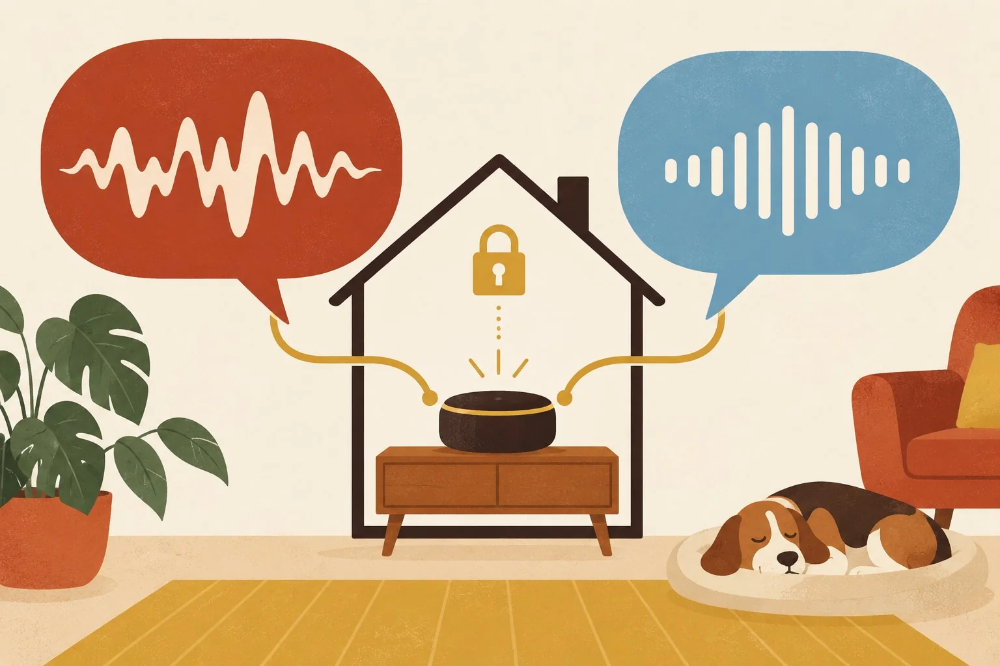

"Mach s Liecht im Wohnzimmer aa." For most people in German-speaking Switzerland, that's simply how you'd say it. Not "Schalte das Licht im Wohnzimmer ein". The question is whether a smart home understands it, and whether it can do so without sending every word to a server somewhere.

Here is where things honestly stand, as of November 2026. It has moved fast, and the cloud assistants have moved fastest.

<figure class="blog-post__figure">
  
</figure>

## Why Swiss German is hard for machines

Swiss German is spoken, not written. There is no standard spelling, every region sounds different, and "Chuchichäschtli" is not in anyone's dictionary. A speech recogniser therefore has to do two things at once: understand the dialect, and write it down as Standard German text that the system can act on. That's a translation task as much as a listening one.

The numbers show how hard that is. According to [apexAI](https://huggingface.co/apexAI-Switzerland/whisper-large-v3-swissgerman), a Swiss AI company that published a fine-tuned model in May 2026, the well-known open speech recogniser Whisper gets roughly one word in four wrong when it hears Swiss German without special training (about 26% word error rate). Their model, trained on recordings from the Swiss parliament, roughly halves that, to about 13%. But they say themselves that it works best on formal speech and worse on spontaneous everyday speech, noisy rooms, and dialects other than Bernese. An independent researcher who tuned Whisper on 1,367 hours of Swiss German TV, parliament and web video reports a smaller gain on that broader mix, from about 29% to about 26% word error rate. Part of that is the yardstick: it counts differences in spelling and word order between dialect and Standard German as errors, and when only real recognition errors are counted, he gets about 14% ([arXiv](https://arxiv.org/html/2606.07608v1)).

## What works today, locally

Home Assistant can process voice entirely on your own hardware, with no recordings leaving the house. It offers two ways of turning speech into text:

- **Speech-to-Phrase** only understands a fixed set of home commands, but it's very fast: under a second, even on a small Konihaus Greenhub.
- **Whisper** tries to understand everything, but needs much more computing power. On a small computer like a Raspberry Pi 4 an answer takes about eight seconds; on a faster mini-PC it's under a second.

Home Assistant's own documentation adds an honest warning: quality varies a lot from language to language, so check how it works in yours.

In practice, that means today:

- **Short commands work well**, especially when spoken somewhat towards Standard German: "Licht Wohnzimmer aus", "Storen runter", "Wie warm ist es im Schlafzimmer?"
- **Free dialect is still where local systems struggle.** A long sentence in broad Zürichdeutsch or Walliserdeutsch is not yet reliably understood by a local system, and this is where the cloud assistants are now ahead.
- **The answer** comes back in Standard German, spoken by a local voice.

<figure class="blog-post__figure">
  
</figure>

## What the cloud assistants do better

Honestly, the big cloud assistants have moved faster than the local ones. When ChatGPT's new voice mode appeared in 2024, it already understood Swiss German, with gaps: in a [Blick test](https://www.blick.ch/digital/neue-stimme-von-chatgpt-im-blick-test-bei-baseldytsch-streikt-sogar-die-kuenstliche-intelligenz-id20185219.html) it followed standard Swiss German but spoke it with a German accent, and it refused to write a poem in Basel dialect. Since then it has improved a lot, and in my own use it follows everyday dialect very well and keeps getting better. If your only question is "will it understand my dialect today", the cloud wins.

The price is that your voice goes to the provider's servers. There is a middle path: Home Assistant's optional cloud has a new speech-to-text engine in testing, aimed at accents, background noise and non-English speech, and Home Assistant states that audio is not logged, stored or used for training ([Home Assistant](https://www.home-assistant.io/blog/2026/09/02/release-20269/)). It is still a step outside your home.

## Why local still matters

The best dialect understanding today sits on someone else's servers, and what you say in your living room goes with it. For switching a light, that is a lot to hand over. The big assistants also come with strings: Apple's new Siri AI, which HomeView is built around, [speaks only English for now](/en/insights/apple-homeview-switzerland/). A local voice system matures more slowly, but what you say stays at home. I wrote more about that in [Your Home, Your Data](/en/insights/privacy-by-default/).

And local is improving quickly too. New models are published every few months, and a system built on Home Assistant can adopt them without new hardware in most cases, as long as the hub has enough power.

## What I want to try next

A fully local voice assistant: speech recognition, a language model and a speaking voice, all on a small server in the house, updated from the internet now and then, but with no audio ever leaving. The parts are starting to exist. Since Home Assistant 2026.8, a local llama.cpp server, or any OpenAI-compatible endpoint, can serve as the conversation agent ([Home Assistant](https://www.home-assistant.io/blog/2026/08/05/release-20268/)). Whisper models tuned for Swiss German are published openly, some under non-commercial licences and others under Apache 2.0 ([arXiv](https://arxiv.org/html/2606.07608v1)). The catch is computing power: models that listen and speak in one go are large (Alibaba's open Qwen3-Omni lists German speech but no dialects, and its maintainers quote tens of gigabytes of GPU memory even for short inputs), so this would be a separate small server, not the Greenhub. I haven't built it yet. It is what I want to test, and I will report what works and what doesn't.

## How I handle it at Konihaus

- **Voice is an option, never the only way.** Every light still has a switch, every scene a button, and everything is in the app.
- **We test with the people who live there.** How someone from Winterthur speaks is not how someone from Brig speaks. Before I promise anything, we try it in your home.
- **Short, clear commands first.** They work today, and they cover most of what people actually say to their home.
- **Local or cloud is your choice.** Local keeps the audio at home. A cloud assistant understands more dialect today. I explain the trade-off and set up what you pick.
- **No guarantees on dialect.** If your grandmother speaks broad dialect and nothing else, I'll tell you honestly that buttons will serve her better for now, unless she is happy to use a cloud assistant.

<figure class="blog-post__figure">
  
</figure>

## Where it's heading

Swiss German voice control that understands everyone, locally and quickly, isn't here yet. But the cloud assistants show what is possible, and the open models are following. I follow the development closely, I want to test a fully local assistant myself, and I'll add what works, so your home learns to understand you a little better over time.

---

**Would you like to try it in your own home?** [Talk to Koni](https://konihaus.ch/#contact). The first conversation is free, with no obligation.
